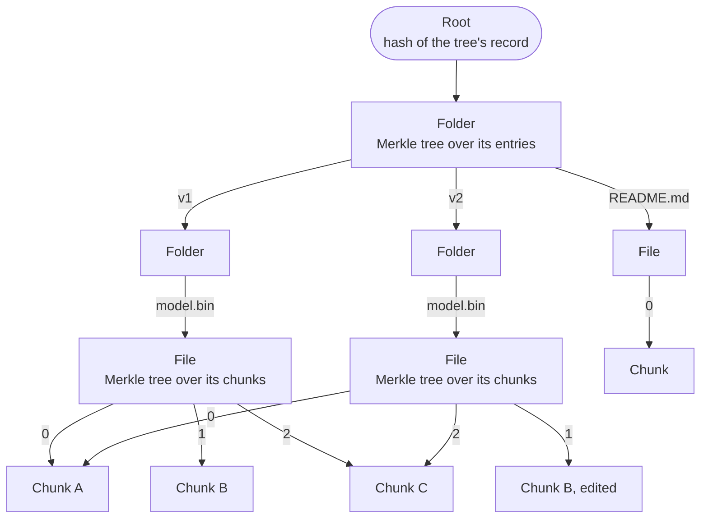

   [](https://github.com/HORNET-Storage/Scionic-Merkle-Tree/actions/workflows/ci.yml) [](https://codecov.io/gh/HORNET-Storage/Scionic-Merkle-Tree)   

# Scionic Merkle Trees

## Combining Merkle Trees and Merkle DAGs

We've designed a [new type of Merkle DAG/Merkle Tree hybrid](https://www.hornet.storage/) known as the Scionic Merkle Tree. Scionic Merkle Trees contain small branches like Classic Merkle Trees, the folder storage support of Merkle DAGs, and numbered file chunks, so anyone can sync a file by its hash and request the range of chunk numbers they are missing. Identical chunks, files and folders have identical hashes wherever they appear, so each one is stored once and sent once.


This repository is the **Go implementation**, at **version 2.5.6**. The Scionic tree format is specified in [`spec/FORMAT.md`](spec/FORMAT.md). The Rust library is the reference for it, and this library is held to the same test vectors, under [`spec/`](spec), byte for byte.



*Two versions of a model in one tree. The second version changed one chunk, so that chunk is the only new data: chunks A and C are stored once and shared. A name belongs to its folder and a chunk number belongs to its file, so a file is the same file wherever it sits and whatever it is called.*

Scionic Merkle Trees maintain the advantages of IPFS Merkle DAGs with the slim Merkle Branches of Classic Merkle Trees. In plant grafting, the "Scion" is the upper part of the plant, chosen for its desirable fruits or flowers; it's grafted onto another plant's base to grow together. In a similar vein, the Scionic Merkle Tree was born from grafting together Merkle Trees and Merkle DAGs. This process emphasizes why we use the term "Scion" for the Scionic Merkle Trees: it symbolizes the digital grafting of these two similar data structures, combining their strengths into one piece of software.

## Contents

- [Scionic Merkle Trees: The Best of Both Worlds](#scionic-merkle-trees-the-best-of-both-worlds)
- [Scionic Merkle Branch Statistics](#scionic-merkle-branch-statistics)
- [Syncing by File Hash and Chunk Number](#syncing-by-file-hash-and-chunk-number)
- [What's New in 2.5.6](#whats-new-in-256)
- [Documentation](#documentation)
  - [Install](#install)
  - [Quick Start](#quick-start)
  - [Syncing Between Two Stores](#syncing-between-two-stores)
  - [Syncing Over a Connection](#syncing-over-a-connection)
  - [What Else It Does](#what-else-it-does)
  - [Stores](#stores)
  - [Errors](#errors)
  - [Words Used in the API](#words-used-in-the-api)
  - [Performance](#performance)
  - [Security](#security)
  - [Known Limitations](#known-limitations)
  - [Specification and Test Vectors](#specification-and-test-vectors)
  - [Other Implementations](#other-implementations)
  - [Development](#development)
  - [License](#license)

## Scionic Merkle Trees: The Best of Both Worlds

### Classic Merkle Trees

Merkle Trees are cryptographic structures used to manage and securely verify large amounts of data. However, there's a significant drawback: they cannot store folders of files.

The number of hashes required for a Merkle proof in a Classic Merkle Tree grows logarithmically with the number of file chunks, meaning the growth rate slows as the tree grows. This pattern makes them very efficient for large datasets.

### Scionic Merkle Trees vs. IPFS Merkle DAGs

Merkle DAGs were developed as a solution to incorporate folders of files, addressing a key limitation of Classic Merkle Trees. However, this structure has its own challenge: to securely download a single file chunk, you must download the hash of every other file chunk inside the folder it's stored in. Each parent leaf keeps growing as the folder grows, even though the size of each Merkle chunk should always remain the same.

Scionic Merkle Trees resolve this flaw, because each Scionic parent leaf is itself chunked using a Classic Merkle Tree, ensuring every part of the Scionic Merkle Tree is uniformly small. In the most extreme cases of P2P decentralization, a user could retrieve each Merkle branch from a different source without needing to download the entire parent leaf first.

### Folders and Subfolders of Files

Like Merkle DAGs, Scionic Merkle Trees can accommodate storing folders of files. An entire directory of files and subfolders can be converted into a Scionic Merkle Tree, and a single file can be a tree on its own.

### Content-Defined File Chunking

Files are split into chunks with content-defined chunking (FastCDC): chunk boundaries are derived from the bytes themselves rather than from fixed offsets, so identical content produces identical chunks no matter where it appears. Editing a large file no longer shifts every boundary after the edit: only the chunks around the edit change, and every other chunk is reused.

Chunk sizes are bounded: more than 512 KiB, 2 MiB on average, and 8 MiB at most, with only a file's last chunk allowed to be smaller. No crafted content can produce a flood of tiny chunks or one giant chunk to stall producers, verifiers or transports. The algorithm is frozen as `fastcdc-v1` in [`spec/FORMAT.md`](spec/FORMAT.md) and pinned by the vectors in [`spec/fastcdc-vectors`](spec/fastcdc-vectors), so every implementation cuts the same bytes at the same places.

### Deduplication at Every Level

A hash covers what a thing is, and never where it sits:

- **A chunk's hash** is the SHA-256 of its bytes, and nothing else.
- **A file's hash** covers the ordered list of its chunks. It does not cover the file's name.
- **A folder's hash** covers its entries: each name with the hash under it. It does not cover the folder's own name.

So the same chunk, the same file and the same folder have the same hash in every tree. A store keeps each of them once, and a sync skips whatever the receiver already holds, whichever tree it first arrived with. A renamed file, a copied folder, and a new version of a large file that changes a few megabytes each cost only what is new.

### Chunked Parent Leaves

Within each parent leaf, the list of children is organized as a Classic Merkle Tree rather than one potentially large list of hashes. This holds for a folder with its entries and for a file with its chunks. Large files and large folders lead to very long lists, and chunking the parent leaf with a Classic Merkle Tree avoids that scaling problem.

### File Chunk Downloading with Chunked Parent Leaves

If a user wants to download a specific file chunk within a Scionic Merkle Tree, they no longer need to download the hash of every other chunk of its file, or the listing of every other file in its folder. Instead, they download a Classic Merkle branch for each parent on the way down from the root. This allows the user to verify that the chunk is part of the tree without the rest of it.

### One Place for Every Name

A folder's entries are sorted by name, and every fork of the folder's Merkle tree records the name at which its right half begins. A name can therefore sit in exactly one place. One branch proves that a name is in a folder and what it holds, and the same kind of branch proves that a name is *not* in the folder. A publisher cannot show one file under a name to a reviewer and a different file under the same name to everyone else.

### Scionic Merkle Tree


### Scionic Merkle Branch


## Scionic Merkle Branch Statistics

*Comparing the size of a Scionic Merkle Branch to the whole parent leaf that a Merkle DAG has you download.* These are bytes on the wire in version 2.5.6, measured by [`examples/proofsizes`](examples/proofsizes). The tests hold this table to that program.

**One file out of a folder**, proven by its name:

| Entries in the folder | The whole folder listing | A Scionic branch | Smaller by |
| ---: | ---: | ---: | ---: |
| 10 | 610 bytes | 300 bytes | **2x** |
| 1,000 | 61 KB | 648 bytes | **94x** |
| 10,000 | 610 KB | 880 bytes | **693x** |
| 1,000,000 | 61 MB | 1,228 bytes | **50,000x** |

**One chunk out of a file**, proven by its number:

| Chunks in the file | About | The file's whole chunk list | A Scionic branch | Smaller by |
| ---: | ---: | ---: | ---: | ---: |
| 10 | 20 MB | 360 bytes | 219 bytes | **2x** |
| 1,000 | 2 GB | 36 KB | 459 bytes | **78x** |
| 10,000 | 20 GB | 360 KB | 619 bytes | **582x** |
| 500,000 | 1 TB | 18 MB | 819 bytes | **22,000x** |

```sh
go run ./examples/proofsizes
```

Scionic Merkle Trees incorporate Classic Merkle Trees within their structure, so their branches grow logarithmically: each time a folder or a file doubles in size, a branch through it grows by one step. In stark contrast, a parent leaf in an IPFS Merkle DAG grows linearly, because the hash of every child must be downloaded to check any one of them.

## Syncing by File Hash and Chunk Number

A Scionic Merkle Tree says what is in it. The root names what is on top, a folder lists its entries, and a file lists its chunks. So a receiver that trusts a root walks down from it, skips everything it already holds by its hash, and asks for the rest:

- **a file by its hash, and its chunks by their numbers**: chunks 100 to 200 of this file;
- **a range of a file's bytes**, for which only the chunks that hold those bytes are sent;
- **one name of a folder**, or a range of its entries.

A chunk's number is its position in its file's list, and the file's hash covers that list, so nobody can lie about a number. A file's hash is the same in every tree, so the same request means the same thing wherever the file appears.

Nothing is compared between the two sides: there is no set reconciliation to run, and no summary of everything held to work out or to send. A phone can read one file out of a tree of terabytes and hold almost nothing. Which chunks of a file a peer holds is one bit per chunk: about 60 KB for a file of a terabyte. Different ranges of one file can be requested from different peers at the same time.

**Everything is verified on arrival.** Every answer is checked against a hash that has already been checked, all the way back to the root, before it is kept or passed on. Nothing is trusted because of who sent it.

## What's New in 2.5.6

Version 2.5.6 is a new tree format, built for deduplication and for trees of a terabyte and more. It does not read trees made by 2.4.x, and the same folder has a different root than it had there.

- **Deduplication comes first.** A chunk's hash covers its bytes alone and a file's hash covers its chunks alone. Names and chunk numbers moved into the parent. Earlier versions hashed a chunk's number into the chunk and a file's name into the file, so the same bytes had different hashes in different places.
- **Syncing no longer needs tree-wide leaf numbers.** LeafSync numbered every leaf of a tree. Syncing now asks for a file by its hash and for its chunks by their numbers within that file, which the file's hash covers.
- **A folder has one place for each name,** so one branch proves that a name is in a folder, or that it is not.
- **Hardened against forged data.** A made-up leaf, a file that comes back short, a chunk that belongs to another file, and a store that is tricked into handing back other bytes are each refused, and each has a test.
- **Bounded memory and work.** Every request says how long its answer may be, a tree's record says how much the tree holds, and writing a tree out counts what it would create before it creates anything.
- **Built for terabytes.** Building and verifying use every core, a file is never held in memory whole, a damaged chunk is named by its hash and fetched again on its own, and any byte range of a file can be read without the rest of it.
- **Safe on disk.** A link is never followed, in building or in writing out, even when one is swapped in while the work is under way.
- **A new API, in one package.** The `dag` package of 2.4.x, with `CreateDag`, `Dag` and the transmission packets, is replaced by `Build`, `Verify`, `Fetch`, `Serve` and `Remote`, in the package at the module's root.

# Documentation

## Install

```sh
go get github.com/HORNET-Storage/Scionic-Merkle-Tree/v2@v2.5.6
```

The package is named `scionic`, and it is the module's root:

```go
import (
	scionic "github.com/HORNET-Storage/Scionic-Merkle-Tree/v2"
)
```

| Requirement | |
| --- | --- |
| Go | 1.26 or newer |
| Systems | Linux, macOS and Windows, each tested on every push, and a 32-bit build on Linux |
| Dependencies | `golang.org/x/sys` |
| `unsafe` and cgo | none in this module |

## Quick Start

Turn a folder into a Scionic Merkle Tree, verify it, read a file out of it, and write the tree back to disk:

```go
package main

import (
	"fmt"
	"log"

	scionic "github.com/HORNET-Storage/Scionic-Merkle-Tree/v2"
)

func main() {
	// A store keeps chunks and lists by their hashes. This one is in memory.
	store := scionic.NewMemoryStore()

	// Build a tree from a folder. The root depends on the folder's contents
	// alone: not on where the folder is, what it is called, or how many
	// goroutines built it.
	root, err := scionic.Build(store, "models/my-model", scionic.BuildOptions{})
	if err != nil {
		log.Fatal(err)
	}
	fmt.Println(root) // bafkrei...

	// Verify everything the store holds for that root: every list, every chunk.
	summary, err := scionic.Verify(store, root)
	if err != nil {
		log.Fatal(err)
	}
	fmt.Printf("%d files, %d bytes\n", summary.Files, summary.Record.Top().Size)

	// Read one file by its path in the tree.
	entry, found, err := scionic.Lookup(store, root, "config.json")
	if err != nil {
		log.Fatal(err)
	}
	if found {
		content, err := scionic.ReadFileBytes(store, entry.Target())
		if err != nil {
			log.Fatal(err)
		}
		fmt.Printf("config.json holds %d bytes\n", len(content))
	}

	// Write the whole tree back out, to a path that does not exist yet.
	if err := scionic.WriteToDisk(store, root, "restored"); err != nil {
		log.Fatal(err)
	}
}
```

A root is written as a CID that begins `bafkrei`. `Root` has a `String` method, `ParseRoot` reads one back, and only that one spelling of a root is read.

## Syncing Between Two Stores

Anything that answers requests is a peer: a connection to another machine, or a store in the same program. This example runs as it stands.

```go
package main

import (
	"bytes"
	"fmt"
	"log"

	scionic "github.com/HORNET-Storage/Scionic-Merkle-Tree/v2"
)

func main() {
	// A publisher builds a tree. Here it is built from bytes in memory.
	publisher := scionic.NewMemoryStore()
	builder := scionic.NewBuilder(publisher, scionic.FastCDCV1)
	readme, err := builder.FileFromBytes([]byte("# My model\n"))
	if err != nil {
		log.Fatal(err)
	}
	weights, err := builder.FileFromBytes(bytes.Repeat([]byte{7}, 3<<20))
	if err != nil {
		log.Fatal(err)
	}
	readmeEntry, err := scionic.NewEntry("README.md", readme, scionic.ExtraData{})
	if err != nil {
		log.Fatal(err)
	}
	weightsEntry, err := scionic.NewEntry("weights.bin", weights, scionic.ExtraData{})
	if err != nil {
		log.Fatal(err)
	}
	top, err := builder.Folder([]scionic.Entry{readmeEntry, weightsEntry})
	if err != nil {
		log.Fatal(err)
	}
	root, err := builder.Finish(top, scionic.ExtraData{})
	if err != nil {
		log.Fatal(err)
	}

	// A responder answers requests from the publisher's store.
	peer := scionic.NewResponder(publisher)

	// Read a part of the tree and keep nothing: find one file by its name,
	// then take 16 bytes from the middle of it. Only the chunk that holds
	// those bytes is sent, and it is verified against the root.
	remote, err := scionic.OpenRemote(peer, root)
	if err != nil {
		log.Fatal(err)
	}
	entry, found, err := remote.Lookup("weights.bin")
	if err != nil || !found {
		log.Fatal("the tree has the file: ", err)
	}
	var middle bytes.Buffer
	if err := remote.Read(entry.Target(), 1<<20, 16, &middle); err != nil {
		log.Fatal(err)
	}
	fmt.Println(middle.Bytes())

	// Or fetch the whole tree into another store. Each part is verified
	// before it is kept, and what the store already holds is skipped.
	mirror := scionic.NewMemoryStore()
	summary, err := scionic.Fetch(mirror, root, peer)
	if err != nil {
		log.Fatal(err)
	}
	fmt.Println(summary.Files, "files")
}
```

## Syncing Over a Connection

Syncing runs over anything that reads and writes bytes: a TCP or QUIC stream, a WebSocket, a pipe. One side serves and the other asks.

```go
import (
	"bufio"
	"net"

	scionic "github.com/HORNET-Storage/Scionic-Merkle-Tree/v2"
)

// serveOnePeer is the side that holds the tree. It answers one peer's
// requests until the peer hangs up.
func serveOnePeer(store scionic.Store, listener net.Listener) error {
	conn, err := listener.Accept()
	if err != nil {
		return err
	}
	defer conn.Close()
	return scionic.Serve(store, conn, bufio.NewWriter(conn))
}

// fetchTree is the side that wants the tree. A fetch that was cut off goes
// on from what the store holds when it is run again.
func fetchTree(address string, root scionic.Root, store scionic.Store) error {
	conn, err := net.Dial("tcp", address)
	if err != nil {
		return err
	}
	defer conn.Close()
	peer := scionic.NewStreamPeer(bufio.NewReader(conn), bufio.NewWriter(conn))
	_, err = scionic.Fetch(store, root, peer)
	return err
}
```

The library verifies everything against the root, so a connection does not have to be trusted for the data to be right. It does not encrypt or authenticate the connection: use TLS or Noise where a transfer should be private.

A writer that has a `Flush` method, as a buffered one has, is flushed by the library where the other side waits for what was written. `Serve` reads its requests through a buffer of its own.

## What Else It Does

| To do this | Use |
| --- | --- |
| Build a tree from a folder or a file on disk | `Build`, `BuildWith`, `BuildOptions` |
| Build a tree from bytes or streams, entry by entry | `Builder` |
| Verify a tree that a store holds, and mend damage | `Verify`, `VerifyWith`, `VerifyOptions` |
| Find a path, read a file, read a range of its bytes | `Lookup`, `ReadFile`, `ReadRange`, `ReadOpen` |
| Write a tree out to disk | `WriteToDisk`, `WriteToDiskWith`, `WriteOptions` |
| Serve a store to peers | `Serve`, `Responder` |
| Fetch a whole tree from a peer | `Fetch` |
| Read parts of a peer's tree and keep nothing | `Remote` |
| Carry a whole tree as one file or stream | `Export`, `Import` |
| List what changed between two trees | `Diff`, `Change` |
| Bring your own transport | `Intake`, `Request`, `Frame`, the `Peer` interface |
| Bring your own storage | the `Store` interface |

**Building.** Building uses every core unless `BuildOptions.Workers` says otherwise. Several files are chunked at once, and the chunks of one long file are hashed several at once. A file is never held in memory whole: a builder holds up to 16 MiB of it, or up to 64 MiB while other goroutines help it. `BuildOptions.Timestamp` writes the time into the tree's record, and `BuildWith` attaches extra data to each entry, such as a file mode or a media type. A link or a special file in the folder is refused, or left out with `LinksSkip`. It is never followed.

**Verifying and mending.** `Verify` checks every list and every chunk that a store holds for a root, on every core. When bytes were harmed where they are kept, the error says which thing it is: it matches `ErrCorrupt`, and carries the hash. With `VerifyOptions{DiscardDamaged: true}` the damaged parts are removed, and the next `Fetch` brings back exactly those. `VerifyOptions.Rechunk` also chunks every file again, and refuses a file that was not chunked the standard way.

```go
	// Verifying finds the damage, and the error names what was harmed.
	_, err = scionic.Verify(mirror, root)
	var damaged *scionic.Error
	if errors.Is(err, scionic.ErrCorrupt) && errors.As(err, &damaged) {
		fmt.Println("the damaged chunk is named:", damaged.Hash == chunk)
	}

	// With DiscardDamaged the damaged parts are removed, and the next fetch
	// brings back exactly those.
	_, err = scionic.VerifyWith(mirror, root, scionic.VerifyOptions{DiscardDamaged: true})
	fmt.Println("it is missing now:", errors.Is(err, scionic.ErrMissing))
	if _, err := scionic.Fetch(mirror, root, scionic.NewResponder(publisher)); err != nil {
		log.Fatal(err)
	}
```

**Bundles and changes.** A whole tree can travel as one stream, and two trees in one store can be compared:

```go
package main

import (
	"bufio"
	"fmt"
	"log"
	"os"

	scionic "github.com/HORNET-Storage/Scionic-Merkle-Tree/v2"
)

func main() {
	store := scionic.NewMemoryStore()
	older, err := scionic.Build(store, "release-1", scionic.BuildOptions{})
	if err != nil {
		log.Fatal(err)
	}
	newer, err := scionic.Build(store, "release-2", scionic.BuildOptions{})
	if err != nil {
		log.Fatal(err)
	}

	// What changed, by path. The chunks that both releases share are held once.
	changes, err := scionic.Diff(store, older, newer)
	if err != nil {
		log.Fatal(err)
	}
	for _, change := range changes {
		fmt.Println(change.Kind, change.Path)
	}

	// The new release as one file: the record, then every list and every
	// chunk once.
	bundle, err := os.Create("release-2.bundle")
	if err != nil {
		log.Fatal(err)
	}
	if err := scionic.Export(store, newer, bufio.NewWriter(bundle)); err != nil {
		log.Fatal(err)
	}
	if err := bundle.Close(); err != nil {
		log.Fatal(err)
	}

	// Reading it back runs the same checks as a fetch from a peer.
	bundle, err = os.Open("release-2.bundle")
	if err != nil {
		log.Fatal(err)
	}
	defer bundle.Close()
	elsewhere := scionic.NewMemoryStore()
	summary, err := scionic.Import(elsewhere, newer, bufio.NewReader(bundle))
	if err != nil {
		log.Fatal(err)
	}
	fmt.Println(summary.Files, "files arrived")
}
```

**Every example in this file is run by the tests,** from the `example_*_test.go` files, and they are shown with the package's documentation.

**Three programs come with the module.** [`examples/roundtrip`](examples/roundtrip) takes a folder the whole way round with a store on disk: it builds the tree, verifies it, fetches it into a second store, reads a range from the middle of its largest file, writes it out again, and holds the copy to the same root, timing each step. [`examples/speed`](examples/speed) measures chunking, hashing, building and verifying into a store in memory, and builds a folder of your own when it is given one. [`examples/proofsizes`](examples/proofsizes) prints the branch sizes in the tables above.

```sh
go run ./examples/roundtrip <folder> <work-dir>
go run ./examples/speed <MiB> [folder]
go run ./examples/proofsizes
```

## Stores

A store keeps bytes under hashes, and that is all the library asks of one. `MemoryStore` is a store in memory, for tests and small trees. A database, a folder on disk or an object store has the three methods of the `Store` interface:

```go
type Store interface {
	// Put keeps bytes under hash. Keeping what is kept already changes
	// nothing. The bytes are lent for the call only: a store that keeps
	// them keeps a copy.
	Put(kind Stored, hash Hash, bytes []byte) error
	// Get gives what is kept under hash, and false if nothing is. The
	// bytes it gives are never changed afterwards, by the store or by the
	// caller.
	Get(kind Stored, hash Hash) ([]byte, bool, error)
	// Remove forgets what is kept under hash.
	Remove(kind Stored, hash Hash) error
}
```

`Stored` says which of four kinds of thing it is: a chunk, a file's chunk list, a folder's listing, or a tree's record. A store never has to understand what it holds: every byte it hands back is checked again before it is used.

A store that can answer without reading the bytes may also have a `Has` or a `Size` method (`StoreHas`, `StoreSize`). The library uses them when they are there, and a store on disk should have `Size` at the least: without it, seeing whether a chunk is there takes a read of the whole chunk. [`examples/roundtrip`](examples/roundtrip) has a complete store that keeps each thing as a file named by its hash.

## Errors

Every error the library returns is an `*Error`. What went wrong is told by matching it with `errors.Is` against one of the package's `Err` values, such as `ErrCorrupt`, `ErrMissing`, `ErrHashMismatch`, `ErrLimitExceeded` or `ErrInvalidData`. The fields of the `*Error` say more where they apply, as `Hash` does for a damaged chunk above: read them with `errors.As`. An error from a store, a reader or a writer of yours is handed back as it is, or wrapped so that `errors.Is` still finds it.

A reader that fails is never taken for one that ended. A file whose reader breaks off, or a stream that fails with its last bytes, is an error, and not a shorter file. A writer that takes fewer bytes than it is given is an error too.

## Words Used in the API

The API and the specification use the same words as this page. This is where each one is found:

| Here | In the API and in `spec/FORMAT.md` |
| --- | --- |
| chunk | `ChunkRef`, `StoredChunk` |
| a file's chunk list | file list: `FileList` |
| a folder's listing | folder list: `FolderList`, made of entries: `Entry` |
| Merkle branch, Merkle proof | branch: `FileBranch`, `FolderBranch` |
| chunking | `Chunking`, `FastCDCV1` |
| root | `Root`, the hash of the tree's record: `Record` |

| File | What it holds |
| --- | --- |
| `format.go` | The bytes of a chunk, a file, a folder, an entry and the record, and the branches that show a part of a list. Reading is strict. |
| `tree.go` | The Classic Merkle Tree of a list: building it, showing a part of it, and checking a part. |
| `fastcdc.go` | Content-defined chunking (`fastcdc-v1`), in memory and as a stream. |
| `build.go` | Building a tree from a folder on disk or from bytes. |
| `intake.go` | The one set of checks for a tree that comes from a peer, comes in a bundle, or sits in a store. |
| `read.go` | Finding a path, reading a file or a range of one, and writing a tree out to disk. |
| `diff.go` | What changed between two trees. |
| `wire.go` | The requests, and the frames that answer them. |
| `sync.go` | Serving a store, fetching a tree, reading parts of a peer's tree, and bundles. |
| `store.go` | The `Store` interface, and a store in memory. |
| `disk.go` and the three beside it | Holding a folder open, so that nothing below it is reached through a link. |

## Performance

Measured on a Windows 11 laptop with Go 1.27. The two programs named in the tables print the same figures on any machine.

| Into a store in memory (`examples/speed`) | |
| --- | ---: |
| Content-defined chunking, one core | 6.0 GiB/s |
| SHA-256 of the chunks, one core | 4.1 GiB/s |
| Building a tree from one file of 1 GiB, every core | 4.4 GiB/s |
| Building a tree from ten files of 256 MiB on disk, every core | 7.0 GiB/s |
| Building a tree from 20,000 files of 4 KiB on disk, every core | 0.14 s |
| Verifying every byte of a tree of 1 GiB, every core | 69 GiB/s |

| With a store on disk, a folder of 3.5 GiB (`examples/roundtrip`) | |
| --- | ---: |
| Building the tree into the store | 1.2 s |
| Verifying every byte from the store | 0.2 s |
| Fetching the tree into a second store | 3.4 s |
| Reading 4 KiB from the middle of a file of 1.5 GiB, through a peer | 2 ms |
| Writing the tree back out as files | 2.8 s |

That folder holds one file of 1 GiB twice. The tree stores it once: 3.5 GiB of files are kept as 2.5 GiB of chunks and 40 KB of lists.

## Security

A receiver trusts one thing: the root. The peer that sends a tree, the network in between, and the bytes that sit in a store are all treated as untrusted. The tests hold the library to the guarantees below with forged bytes ([`forgery_test.go`](forgery_test.go), [`forgery_shape_test.go`](forgery_shape_test.go)), which are made by a second, independent copy of the format's rules ([`oracle_test.go`](oracle_test.go)).

**What is verified**

- **No forged content.** A made-up child under a folder or a file, a real child's branch offered with another child, a file offered as a folder, a list offered as a chunk, and a file given another file's chunks are all refused.
- **No short files.** A file never comes back shorter than it is. If a chunk is missing, reading is an error.
- **One name, one place.** A folder cannot show one name at two places, even if it was put together out of order on purpose.
- **Every byte of a branch counts.** A branch that differs in any one byte is refused, so no two branches prove the same thing.
- **Nothing is kept before it is verified.** A frame that nothing asked for is refused and not kept. A list that fails a check is not kept either, and that transfer takes nothing more.

**What is bounded**

- **Memory.** A peer cannot make a receiver set aside more memory than the tree it trusts calls for: every request says how long its answer may be.
- **Size.** A tree's record says how much the tree holds, and taking it in stops as soon as it would hold more.
- **Expansion.** A small tree that stands for an endless one, by holding one folder under many names, is counted before it is written out, and refused.
- **Malformed input** is an error, and never a crash or a loop.
- **Waiting.** A reader that never gives a byte is given up after a hundred tries, and nothing waits for a goroutine that is gone.

**What a store can count on**

- **Damage is found and named.** Bytes that were harmed in a store are found when the tree is verified, and named by their hash. They can be removed and fetched again on their own.
- **A peer cannot delete your data.** Nothing a peer sends makes a store remove bytes that are sound. A list that names a held chunk with a wrong length is refused, and the chunk stays.

**What happens on disk**

- **A link is never followed when a tree is built.** That holds for a link that is in the folder, and for one that takes a file's or a folder's place while the folder is being read. Each folder is held open while it is read, and what is in it is opened from the folder itself, never by a path that is looked up again.
- **Nothing is written outside the destination.** A tree is written only to a new place, and only with names the system can hold as they are. The new folders are held open while they are filled, so a link that takes the place of one is not written through.
- **A file is read under its own name.** Windows drops a dot or a space from the end of a name when it looks a path up, and takes `NUL` for a device wherever it stands, so a file `model.` beside a file `model` would be read as `model`. Everything below the folder a caller names is opened by a path that Windows takes letter for letter.
- **Whatever is held open is let go of,** however the work ends: with an error, or with a store of yours that panics.

The exact rules are in [`spec/FORMAT.md`](spec/FORMAT.md), under "What a receiver checks", "Limits", "Building a tree" and "Writing a tree out".

## Known Limitations

- **One file is chunked on one core,** because where a chunk ends decides where the next begins. That is about 6 GiB a second on the machine above. Hashing the chunks, which is the greater part of the work, uses every core.
- **Fetching a tree and writing a tree out use one core each.** On the disks they were tried on, the disk was the slower part.
- **Verifying or fetching a whole tree keeps a small record in memory for every different chunk,** so that each chunk is counted once: some tens of megabytes for a terabyte.
- **A list is taken in whole.** A file's chunk list is 36 bytes a chunk, about 18 MB for each terabyte of the file, and a folder's listing has to fit in memory.
- **A tree is built from a folder as the folder is while it is read.** If another program changes files in it meanwhile, the tree can hold a mix of old and new. It cannot be led outside the folder.
- **Links, special files and file permissions are not stored.** An entry's extra data has room for a caller to record a mode.
- **A responder that tells a peer which chunks of a file it holds looks into its store for each of them.** `Responder.Have(false)` switches that off for one that serves strangers.
- **A connection has to hold 2,048 bytes of requests on their way,** which every connection over a network does. Go's `net.Pipe` and `io.Pipe` hold nothing: between a `StreamPeer` and a `Serve` they work all the same, and for an answerer of another make there is `StreamPeer.Ahead(0)`.
- **On Windows, opening a file so that it cannot be led astray costs more than a plain open.** With every core at work it does not show. While a folder is being read on Windows, other programs cannot rename or delete it.
- **On systems that are neither Unix nor Windows, a folder is not held open,** and a link that is swapped in while a folder is read can be followed.

## Specification and Test Vectors

- [`spec/FORMAT.md`](spec/FORMAT.md) is the format: what every hash covers, what a receiver checks, the bytes of every request and answer, and the limits.
- [`spec/vectors/manifest.json`](spec/vectors/manifest.json) holds the shared vectors, which the Rust library makes and every implementation is held to, byte for byte: 7 whole trees with every one of their bytes, 9 branches of them, 8 lookups of a name, 12 requests with their answers, 3 exchanges on a connection, and 76 forged inputs that must be refused. [`spec/vectors/README.md`](spec/vectors/README.md) says how a library reads the file.
- [`spec/fastcdc-vectors/manifest.json`](spec/fastcdc-vectors/manifest.json) pins where 11 files are chunked, and what each file hashes to.

The files under `spec/` are the Rust library's, copied byte for byte. The tests check the vectors' own hash before they use them.

## Other Implementations

| Implementation | Version | |
| --- | --- | --- |
| Go, this repository | 2.5.6 | |
| [Rust](https://github.com/HORNET-Storage/Scionic-MerkleTree-Rust) | 2.5.6 | The reference for the format. |
| [Swift](https://github.com/HORNET-Storage/Scionic-MerkleTree-Swift) | 2.4.3 | Being brought to 2.5.6. |

The three libraries are kept in step: one format, one set of vectors and one version number. A tree built by the Rust library and one built by this library from the same folder have the same root, and each reads what the other writes. Until Swift reaches 2.5.6 it writes the 2.4.x layout, which this version does not read.

## Development

```sh
gofmt -l .
go vet ./...
go test -race ./...
```

CI runs these on Linux, macOS and Windows on every push, runs the tests once more on Go 1.26, the oldest version the module supports, and once as a 32-bit program. The tests also hold this file to the module: its Go code is taken from files that are compiled and run, and its tables of branch sizes from the program that measures them.

## License

Released under the MIT License: see [`LICENSE`](LICENSE).
